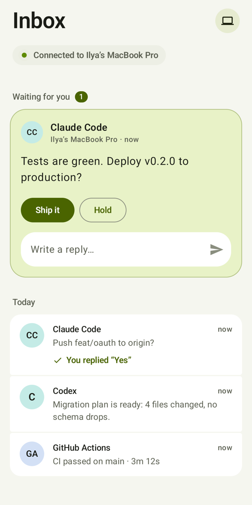
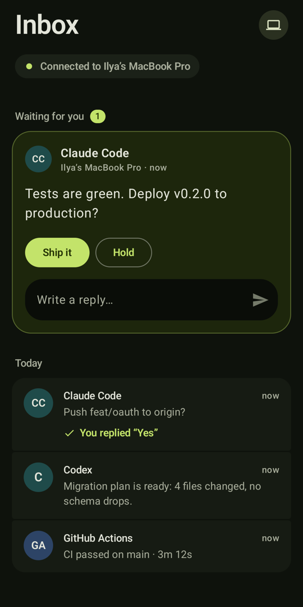
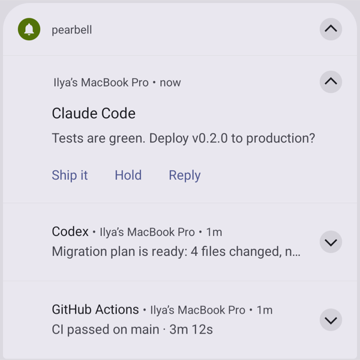

# pearbell

Send a message from your terminal to your Android phone. Get the answer back. No server, no account.

pearbell is a small ntfy.sh alternative for AI coding tools. An agent can tell you that a job is done, or ask you a question and wait for your reply. It runs on the [Pear](https://pears.com/) peer-to-peer stack: HyperDHT finds the peers and opens an end-to-end encrypted Noise connection, and Bare Kit runs the same JavaScript inside the Android app.

```bash
pearbell send -t "Claude Code" "Refactor done, 42 tests pass"
pearbell ask -a "Yes,No" "Push the branch to origin?"   # prints: Yes
```

Ways to use it:

- **CLI:** `pearbell send` and `pearbell ask` from a terminal, a script or a hook. See [All commands](#all-commands).
- **MCP:** `pearbell mcp` gives Claude Code and other AI tools `send`, `update`, `ask` and `devices` tools. See [MCP server](#mcp-server).
- **HTTP:** a local web API (and the same MCP tools at `/mcp`) for tools that can only make web requests. See [HTTP API](#http-api).
- **Desktop:** a Mac menu bar app shows messages while you're at the Mac and hands them to the phone when you step away. See [The Mac menu bar app](#the-mac-menu-bar-app).
- **Android:** the phone app gets notifications, answers questions and keeps an inbox. See [Install the Android app](#install-the-android-app).

<p align="center">
  
  &nbsp;
  
</p>

## Quick start

Install the CLI and the app first (see [Install the CLI](#install-the-cli) and [Install the Android app](#install-the-android-app)). Then:

**1. Pair once.** On your computer:

```console
$ pearbell pair
█▀▀▀▀▀█ ▄▀▄ █▀▀▀▀▀█
█ ███ █ ▀█▄ █ ███ █      (a QR code)
▀▀▀▀▀▀▀ ▀ ▀ ▀▀▀▀▀▀▀
Scan this in the pearbell app, or paste the code:

  pearbell1:3ideim8m3uw7qwhh…:b7df5544a8114e40…

Waiting for the phone...
Paired with Pixel 8
```

In the app, give the phone a name (it starts as the device name from Android's settings), then tap **Scan QR code** (or **Enter the code instead** and paste it). The CLI prints the phone's name, the app says "You're paired", and the inbox shows "Connected to" your computer. You can rename the phone later on the app's Computers screen; paired computers pick up the new name.

**2. Send a notification.** It arrives as a normal Android notification and lands in the inbox. In the app, tap a message to see which computer sent it and exactly when. Swipe left to archive it, right to delete it (both can be undone).

```console
$ pearbell send -t "GitHub Actions" "CI passed on main · 3m 12s"
delivered to Pixel 8
```

**3. Ask a question and wait.** `ask` blocks until you answer on the phone, then prints the answer to stdout:

```console
$ pearbell ask -t "Claude Code" -a "Ship it,Hold" "Tests are green. Deploy v0.2.0 to production?"
delivered to Pixel 8
Ship it
```

<p align="center">
  
</p>

Answer from the notification (tap a button, or **Reply** to type) or from the app's **Waiting for you** card. Only the answer goes to stdout; progress lines go to stderr. So scripts can branch on it:

```bash
answer=$(pearbell ask -q -a "Ship it,Hold" "Deploy v0.2.0?") || exit 1
if [ "$answer" = "Ship it" ]; then ./deploy.sh; fi
```

If nobody answers in time, `ask` exits with code `2` (the default timeout is 10 minutes; change it with `--timeout`).

## How it works

```
 terminal                       your computer                          phone
 ─────────                      ─────────────                          ─────
 pearbell send ──unix socket──▶ pearbell daemon ◀──HyperDHT (Noise)─── pearbell app
 pearbell ask  ◀── reply ─────  (auto-started)  ─── msg ─────────────▶ notification
                                                ◀── reply ───────────  (buttons / text)
```

- **The phone always dials the computer.** Many phones sit behind carrier NATs that refuse incoming connections. So the app keeps one open connection to each paired computer and redials when it drops (1 s back-off, up to 30 s, and at once on a network change).
- **The daemon** listens on the computer's HyperDHT key. Any `pearbell` command starts it in the background. It holds messages until each phone has them (up to a day), so a phone that is offline gets them later.
- **Pairing** uses a one-time code: the computer's public key plus a random token. After pairing, each side only accepts the other's key.
- **Replies** come from the notification (quick buttons or a typed reply) or from the app. If the phone is offline when you answer, the reply goes out when it reconnects.

## The Mac menu bar app

On a Mac, the optional menu bar app shows messages as Mac notifications while you are at the Mac, and leaves them to the phone when you step away (screen locked, Mac asleep, or no input for 5 minutes). A question you leave unanswered on the Mac moves on to the phone, and an answer on either closes it on both. Click a notification to open the message; the inbox renders Markdown, filters by topic, and can snooze the Mac for an hour. See [macos/README.md](macos/README.md).

```console
$ pearbell send "Build finished"
routed to the Mac: you are using it
delivered to this Mac
```

## Install the CLI

You need Node 20 or later.

```bash
npm install -g pearbell
pearbell --help
```

To update, run `npm install -g pearbell@latest`. To remove it, run `npm uninstall -g pearbell`.

To hack on it instead, use a clone:

```bash
git clone https://github.com/knownasilya/pearbell && cd pearbell
npm install
npm link        # puts this checkout's `pearbell` on your PATH
```

Identity and paired phones live in `~/.config/pearbell/` (set `PEARBELL_HOME` to change it). The daemon logs to `daemon.log` in the same folder.

**Keep the daemon running.** Any `pearbell` command starts the daemon, but after a reboot nothing runs until you use one. If other tools send through it (see [HTTP API](#http-api)), install the service so it starts at login and comes back if it stops. On macOS that's a launch agent; on Linux, a systemd user service:

```bash
pearbell service install     # macOS: ~/Library/LaunchAgents/dev.pearbell.daemon.plist
                             # Linux: ~/.config/systemd/user/pearbell.service
pearbell service status
pearbell service uninstall
```

While it is installed, `pearbell stop` and `pearbell http on` restart the daemon through launchd or systemd. On Linux, a user service stops when you log out; to keep it running on a server you don't stay logged in to, run `loginctl enable-linger $USER` once.

## Install the Android app

It needs Android 10 or later. Get the APK one of these ways:

- **A release:** download `pearbell-vX.Y.Z.apk` from the [Releases](https://github.com/knownasilya/pearbell/releases) page.
- **The latest build:** open the newest green run under [Actions](https://github.com/knownasilya/pearbell/actions/workflows/android.yml) and download the `pearbell-apk` artifact (a zip with the APK inside).

Open the APK on the phone and allow installs from that source. Or, with USB debugging on: `adb install pearbell-*.apk`.

**Updates.** The app checks the GitHub releases every hour and installs new versions itself. Android asks you to confirm the first update; on Android 12 and later, the ones after that can install without a prompt. Turn this off, or check by hand, on the Computers screen.

> **Coming from v0.1.0?** It was signed with a throwaway key, so it can't update itself. Uninstall it once and install v0.2.0 or later by hand; updates work from then on. (You'll need to pair again.)

On first start, allow notifications. Then tap **Allow** on the "Stay reachable" card. Without it, Android may cut the connection while the screen is off.

### Build it yourself

```bash
npm run android:fetch-bare-kit   # once; downloads the Bare Kit prebuild (~400 MB zip, needs gh)
npm run android:build            # android/app/build/outputs/apk/release/app-release.apk
```

Building needs JDK 17 or later and the Android SDK (`ANDROID_HOME`, or `sdk.dir` in `android/local.properties`). With the phone plugged in, `npm run android:install` installs a debug build.

### CI and releases

[.github/workflows/android.yml](.github/workflows/android.yml) runs the tests and builds the APK on every push and pull request.

Releases use [release-plan](https://github.com/release-plan/release-plan). Give each pull request one label: `breaking`, `enhancement`, `bug`, `documentation` or `internal`. After a merge to main, a "Prepare Release" pull request shows the next version and its changelog. Merge it to publish to npm, tag the release and build the APK for it. See [RELEASE.md](RELEASE.md).

**Signing.** Android installs an update only if it is signed with the same key as the installed app, so releases are signed with one long-lived key from the repository secrets below. Never lose or replace it: apps signed with the old key could not update anymore. Without these secrets (in a fork, say), CI signs each build with a new throwaway key. To create a key:

```bash
keytool -genkeypair -keystore pearbell.jks -alias pearbell -keyalg RSA -keysize 4096 -validity 10000
gh secret set ANDROID_KEYSTORE_BASE64 < <(base64 -i pearbell.jks)
gh secret set ANDROID_KEYSTORE_PASSWORD
gh secret set ANDROID_KEY_ALIAS --body pearbell
gh secret set ANDROID_KEY_PASSWORD
```

## All commands

You can pair one phone with many computers, and one computer with many phones. `send` and `ask` go to every paired phone unless you pick one with `-d`; the first answer wins, and the other phones close the question.

```bash
pearbell send "Build finished"                 # notification
pearbell send -t "CI" -d pixel "Deploy done"   # title, one phone only
pearbell send -T builds "Nightly build is green"   # grouped under "builds" in the app
pearbell ask "Which branch name?"              # waits, prints the reply
pearbell ask -a "Approve,Reject" "Run migration 0042?"
git log -1 | pearbell send -t "New commit" -   # body from stdin
pearbell ask --json "Continue?"                # {"id":"…","reply":"…","device":"…"}

pearbell devices    # paired phones, online or not
pearbell unpair pixel
pearbell start      # start the background daemon (any command does)
pearbell stop       # stop the background daemon
pearbell mcp        # MCP server for AI tools, see "Use it with AI tools"
pearbell listen -T builds   # print what you write to "builds" on the phone
pearbell inbox -T builds    # print (and take) what waited there
```

| Option | Meaning |
| --- | --- |
| `-t, --title` | Notification title |
| `-T, --topic` | Group the message under a topic in the app (up to 40 characters) |
| `-a, --actions a,b,c` | Up to 3 quick-reply buttons (the notification shows 2 plus Reply) |
| `-i, --id` | Your own id for the message (up to 64 characters, no spaces), so [`pearbell update`](#update-a-message) can change it |
| `-d, --device` | Only this phone (name or start of its key) |
| `--to` | `auto` (default), `mac`, `phone` or `all`. With the [menu bar app](#the-mac-menu-bar-app) running, `auto` uses the Mac while you are at it. |
| `-w, --wait` | Wait for a reply (`send -w` is `ask`) |
| `--timeout s` | `send`: wait this long for delivery (default 10). `ask`: wait this long for a reply (default 600). `0` waits forever. |
| `--json` | Machine-readable output |
| `-q, --quiet` | No progress lines on stderr |

Exit codes: `0` ok, `1` error, `2` timeout. When `send` times out before delivery, it still exits `0`: the message waits in the daemon's queue.

### Topics

Give messages a topic (`-T builds`, or `"topic": "builds"` in the HTTP API) to group them. The app then shows one line of topic chips above the inbox and the archive, with a count for each, so you can see one topic at a time. Topics that don't fit sit behind the last chip ("+3"), which opens a list of every topic with its count and when its last message came. Each message shows its topic, and so does its notification.

You can also write to a topic from the phone, to ask whatever works on it how it's going. See [Ask a topic from your phone](#ask-a-topic-from-your-phone).

### Long messages

A message can hold up to 16,000 characters. A longer one is cut with a "… (cut: N more characters)" note at the end, the CLI warns about it, and the HTTP API adds `"truncated": true` to its reply. The inbox shows the first three lines; tap the message, or its notification, to read all of it.

### Markdown

Message text is Markdown. The app shows **bold**, *italic*, `code`, ~~strike~~, headings, lists, task lists (`- [ ]` and `- [x]`), quotes, fenced code blocks, tables and images. Links (`[text](https://…)`, `<https://…>` or a bare `https://…`) open in the browser when you tap them on a question card or in a message's details. Only `http`, `https` and `mailto` links open. Notifications show the text without the markup.

Tables use GitHub's syntax: a header row, a `| --- |` row (`:--`, `:-:` and `--:` align a column left, center or right), then a row per line. Cells don't wrap, so a wide table or a long code line scrolls sideways. An image on a line of its own, ``, shows in the message once it loads; only `https` images load, and the alt text stands in until then (and in the inbox preview and notifications). Loading an image fetches it from its server, which sees your phone's or Mac's IP address.

```bash
pearbell ask -a "Ship it,Hold" "## Deploy ready
PR **#42** is green: [view it](https://github.com/you/app/pull/42)
- \`npm test\`: 211 passed"
```

### Update a message

Give a message an id with `--id`, and `pearbell update <id>` changes it in place on the phone and the Mac: new text, and a new title or topic if you pass `-t` or `-T`. An update makes no new notification sound; a notification that is still showing gets the new text. Updated messages say **updated** with the time of the last change. If the phone no longer has the message (you deleted it, say), the update shows as a new one.

Task lists make this handy for progress: `- [ ] task` shows as an open box and `- [x] task` as a ticked one.

```bash
pearbell send -t "Release" --id release-0.9 "- [ ] Tests
- [ ] Build the APK
- [ ] Publish"

pearbell update release-0.9 "- [x] Tests
- [x] Build the APK
- [ ] Publish"
```

An id points to the newest message from this computer that has it. `ask --id` works too; an update changes the question's text and leaves it open.

## HTTP API

Some tools can only make web requests: a [Kody](https://github.com/kentcdodds/kody-celld) job, a webhook relay, iOS Shortcuts. For those, the daemon can also listen on a local port:

```bash
pearbell http on            # prints the URL (http://127.0.0.1:7457) and a token
pearbell http               # show them again
pearbell http rotate        # new token
pearbell http off
```

It listens on `127.0.0.1` only, and every request needs `Authorization: Bearer <token>`.

```bash
curl -s http://127.0.0.1:7457/send -H "authorization: Bearer $TOKEN" \
  -d '{"title":"Build","body":"**Tests passed**"}'
# {"id":"…","delivered":["Pixel 8"],"queued":[]}

curl -s http://127.0.0.1:7457/send -H "authorization: Bearer $TOKEN" \
  -d '{"body":"Deploy?","actions":["Yes","No"],"wait":true,"timeout":300}'
# {"id":"…","reply":"Yes","device":"Pixel 8"}   (504 {"error":"timeout"} if no answer)

curl -s http://127.0.0.1:7457/send -H "authorization: Bearer $TOKEN" \
  -d '{"id":"deploy","body":"- [ ] build\n- [ ] ship"}'
curl -s http://127.0.0.1:7457/update -H "authorization: Bearer $TOKEN" \
  -d '{"id":"deploy","body":"- [x] build\n- [ ] ship"}'
```

The `id` you give is your own; the `id` in the answer is the daemon's, and the answer repeats yours as `key`.

| Endpoint | Body | Answer |
| --- | --- | --- |
| `POST /send` | `body` (required), `title`, `topic`, `actions` (array or `"a,b"`), `id`, `device`, `to`, `wait`, `timeout` (seconds) | `{ id, route, delivered, queued }`, or with `wait`: `{ id, reply, device }` |
| `POST /update` | `id` and `body` (required), `title`, `topic`, `device`, `to`, `timeout` | as `/send` without `wait` |
| `GET /devices` | | `[{ name, publicKey, connected }]` |
| `POST /mcp` | a JSON-RPC message (MCP) | its answer; see [MCP server](#mcp-server) |

Without `wait`, `timeout` is how long to wait for delivery (default 10 s); a phone that is offline gets the message later. With `wait`, it is how long to wait for a reply (default 600 s).

## Use it with AI tools

### MCP server

`pearbell mcp` is a [Model Context Protocol](https://modelcontextprotocol.io) server. It gives an agent typed tools, so it doesn't need to know the CLI flags or quote Markdown in a shell string. Add it to Claude Code once, for all your projects:

```bash
claude mcp add --scope user pearbell -- pearbell mcp
```

Then run `/mcp` in Claude Code to check that it is connected. The server starts the daemon if it isn't running, like any `pearbell` command. Its tools:

| Tool | Arguments | What it does |
| --- | --- | --- |
| `send` | `body`, and optionally `title`, `topic`, `id`, `device`, `to` | Sends a notification. Returns once it is delivered, or queued for a phone that is offline. |
| `update` | `id`, `body`, and optionally `title`, `topic`, `device`, `to` | Changes the message sent with that `id`, without a new notification. Good for ticking off a task list. |
| `ask` | `body`, and optionally `actions` (up to 3), `timeout` (seconds, default 600, `0` waits forever), `title`, `topic`, `id`, `device`, `to` | Asks a question and waits for the answer. If the agent stops waiting (you press Esc, say), the question closes on the phone. |
| `devices` | | Lists the paired phones, whether each is online, and whether the menu bar app is running. |

The arguments mean the same as the [command options](#all-commands). Results are JSON, such as `{"id":"…","reply":"Ship it","device":"Pixel 8"}` from `ask`. A failure (no paired phone, no answer in time) comes back as a tool error the agent can read.

For other MCP clients (Claude Desktop, Cursor and so on), add a stdio server with the command `pearbell` and the argument `mcp`:

```json
{
  "mcpServers": {
    "pearbell": { "command": "pearbell", "args": ["mcp"] }
  }
}
```

The client may not see the `PATH` from your shell. If it can't find `pearbell`, use the full path from `which pearbell`.

**Over HTTP.** Some MCP clients, such as [Kody](https://github.com/kentcdodds/kody-celld), connect only over HTTP. With the [HTTP API](#http-api) on, the daemon serves the same tools at `/mcp` (Streamable HTTP, JSON answers), behind the same token:

```bash
pearbell http on    # prints the URL and the token
```

Then add `http://127.0.0.1:7457/mcp` as an MCP server with the token as its bearer token. In Kody: `kody.mcpServerAdd({ name: 'pearbell', url: 'http://127.0.0.1:7457/mcp', bearerToken: '<token>' })`. The client must run on the same computer, since the API only listens on `127.0.0.1`.

To tell the agent when to use it, add to `CLAUDE.md` or `AGENTS.md`:

```md
When you need my input or a decision, ask with the pearbell ask tool instead
of asking in the chat, with the project folder name as the topic. It shows on
my Mac while I use it and on my phone when I step away.
For long jobs, send a task list with pearbell send and an id, and tick
the steps off with pearbell update.
```

Prefer the ask tool over `pearbell ask` in a shell. By default, Claude Code stops a shell command after two minutes, and an ask can wait ten.

### Claude Code hooks

Hooks run shell commands, so they use the CLI. Put this in `~/.claude/settings.json` to get a ping when Claude needs you or finishes. The project folder becomes the topic, and the Stop hook sends Claude's last reply in full. pearbell marks anything over 16,000 characters as cut, so there is no need to shorten it:

```json
{
  "hooks": {
    "Notification": [
      { "hooks": [{ "type": "command", "command": "jq -r .message | pearbell send -q -t 'Claude Code' -T \"$(basename \"$CLAUDE_PROJECT_DIR\" | cut -c1-40)\" -" }] }
    ],
    "Stop": [
      { "hooks": [{ "type": "command", "command": "jq -r '.last_assistant_message // \"Finished, waiting for you\"' | pearbell send -q -t 'Claude Code · done' -T \"$(basename \"$CLAUDE_PROJECT_DIR\" | cut -c1-40)\" -" }] }
    ]
  }
}
```

### Ask a topic from your phone

From the phone you can write to a topic that a computer has sent messages under, and get an answer from the Claude Code session working on it. Pick the topic's chip in the inbox: a bar at the bottom says "Ask pearbell…", with a **Progress?** button that asks for a status update in one tap. Or open the list of topics and tap **Ask** next to one.

What you write shows in the inbox as your own message, with what came of it: **Heard by 1 session**, **Queued** for Claude's next step (see hooks below), **Waiting for** a computer that is offline (it goes out when the phone reconnects), or **Nobody listening**. The answer comes back as a normal message on the same topic.

A session on the computer can pick it up in two ways. Both use the project folder's name as the topic, like the [hooks](#claude-code-hooks) below.

**With hooks (no flags).** When nothing listens on the topic, the daemon keeps what you write for an hour, and `pearbell inbox --hook` hands it to Claude from a hook. Add these to the `hooks` in `~/.claude/settings.json`, next to the ones below:

```json
{
  "hooks": {
    "PostToolUse": [{ "hooks": [{ "type": "command", "command": "pearbell inbox --hook" }] }],
    "UserPromptSubmit": [{ "hooks": [{ "type": "command", "command": "pearbell inbox --hook" }] }],
    "Stop": [{ "hooks": [{ "type": "command", "command": "pearbell inbox --hook" }] }]
  }
}
```

After each step Claude takes, it sees what you wrote and answers with the pearbell send tool (or `pearbell send`). If it was about to finish, the Stop hook keeps it going long enough to answer. The phone says **Queued** until a hook takes the message, then **Heard by 1 session**. A session that sits idle waiting for you at the terminal runs no hooks, so it answers when you next give it something to do. The hook prints nothing when nothing waits, and never starts the daemon.

**As a channel (answers even when idle).** `pearbell mcp --channel` makes the MCP server a [Claude Code channel](https://code.claude.com/docs/en/channels), which can wake an idle session:

```bash
claude mcp add --scope user pearbell -- pearbell mcp --channel
```

Channels are a research preview, so Claude Code only loads one that is not on its allowlist when you start it like this. It shows a warning screen the first time:

```bash
claude --dangerously-load-development-channels server:pearbell
```

Pick another topic with `-T` or `$PEARBELL_TOPIC`. A message that comes while Claude is busy waits for its next turn. Start Claude without the flag and the phone still says **Heard**, but Claude Code drops the message.

Anything else can listen too: `pearbell listen -T builds` prints each message (`--json` for one JSON object per line) until you stop it, and `pearbell inbox -T builds` prints what is queued and takes it.

### Without MCP

An agent that can run shell commands can use the CLI. Add to `CLAUDE.md` or `AGENTS.md`:

```md
When you need a decision from me and I seem away, run
`pearbell ask -a "Yes,No" "<question>"` and use the printed reply.
```

## Develop

```bash
npm test                     # daemon and phone core on a local HyperDHT testnet
npm run fake-phone -- pair <code>   # a phone stand-in in Node, on the real DHT
npm run fake-phone           # listen; type a reply and press Enter, or "@topic text"
```

`FAKE_PHONE_AUTO=yes npm run fake-phone` answers every question at once.

### Layout

- [shared/](shared): code for both sides. [phone.js](shared/phone.js) is the phone core (links, message store); [protocol.js](shared/protocol.js) has the wire frames and pairing codes; [lines.js](shared/lines.js) frames JSON over streams.
- [cli/](cli): [bin.js](cli/bin.js) (commands), [daemon.js](cli/daemon.js) (HyperDHT server, queue, topic listeners), [control.js](cli/control.js) (local socket, daemon auto-start), [router.js](cli/router.js) (Mac or phone), [mcp.js](cli/mcp.js) (MCP server and channel), [hook.js](cli/hook.js) (`inbox --hook` output), [http.js](cli/http.js) (HTTP API).
- [macos/](macos): the SwiftUI menu bar app. It talks to the daemon over the local socket.
- [android/](android): Kotlin app. [app.js](android/app/src/main/js/app.js) is the Bare worklet entry, bundled with `bare-pack` and linked with `bare-link` during the Gradle build. [BellService.kt](android/app/src/main/java/dev/pearbell/BellService.kt) is a foreground service that keeps the worklet alive and talks to it over Bare Kit IPC.

## Limits

- **Android only** on the phone side for now. The phone core is plain Bare JavaScript, so an iOS app could reuse it. But iOS does not let apps keep a connection open in the background, so it would need a push service.
- **The computer must be on** with the daemon running. After a reboot, the daemon starts with your next `pearbell` command (or at login with `pearbell service install`), and the phone finds it within 30 seconds.
- **Two strict NATs** (for example, both sides on carrier networks) can still fail to connect. A computer on a home or office network is fine.
- **Battery.** The app holds one idle encrypted connection per computer. That costs little, but it is not free.
